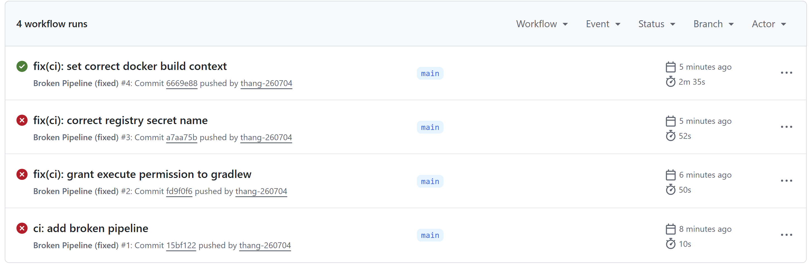
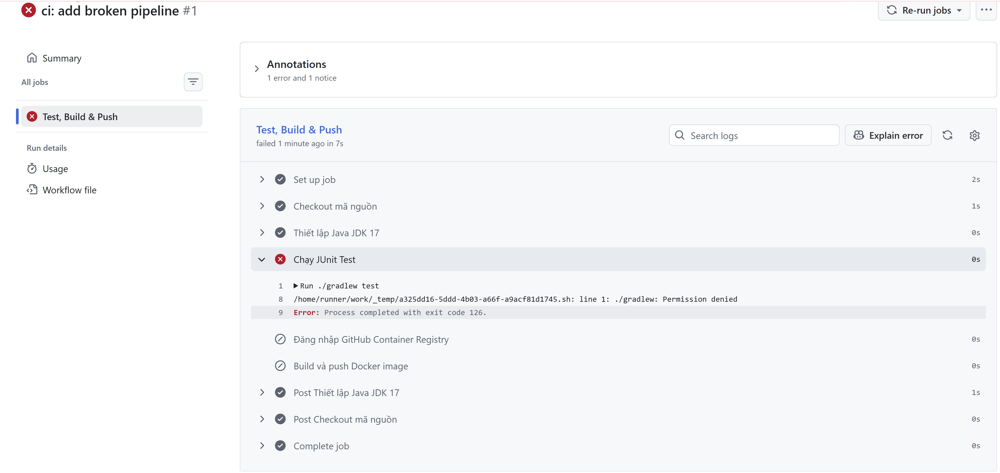
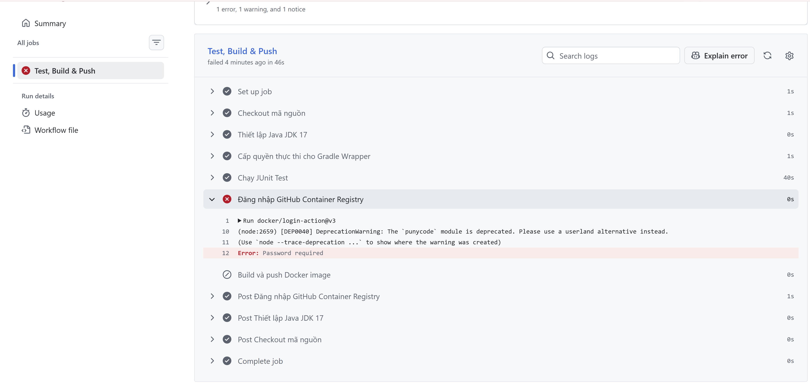
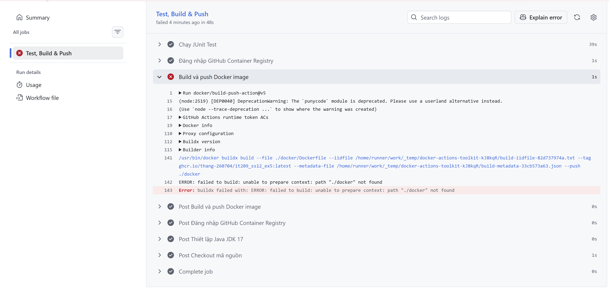
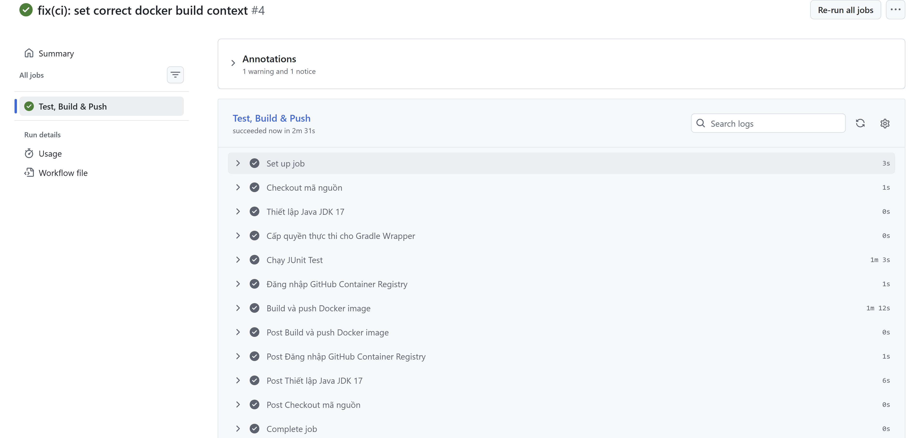

# Session 12 - Bài 5: Chẩn đoán và khắc phục 3 sự cố đứt gãy Pipeline CI/CD

- Repository: <https://github.com/thang-260704/IT209_Ss12_Ex5>
- Workflow: [`.github/workflows/broken-pipeline.yml`](.github/workflows/broken-pipeline.yml)
- Pipeline: `checkout` → `setup-java` → `chmod gradlew` → `./gradlew test` → `docker login ghcr.io` → `docker build & push`

## Phương pháp

Các step trong một job chạy **tuần tự**; step nào lỗi thì job dừng ngay, các step sau bị bỏ qua. Vì vậy 3 lỗi lộ ra **lần lượt**: sửa lỗi trước mới thấy được lỗi sau. Mỗi lần sửa một lỗi, push một commit, đọc log của step đỏ trên tab Actions rồi xử lý tiếp.

| Run | Commit | Step thất bại | Kết quả |
|---|---|---|---|
| #1 | `ci: add broken pipeline` (`15bf122`) | Chạy JUnit Test | ❌ Lỗi 1 |
| #2 | `fix(ci): grant execute permission to gradlew` (`fd9f0f6`) | Đăng nhập GitHub Container Registry | ❌ Lỗi 2 |
| #3 | `fix(ci): correct registry secret name` (`a7aa75b`) | Build và push Docker image | ❌ Lỗi 3 |
| #4 | `fix(ci): set correct docker build context` (`6669e88`) | — | ✅ Toàn bộ pipeline xanh |

Thời gian chạy tăng dần qua từng lần sửa (10s → 50s → 52s → 2m 35s), đúng với việc mỗi lần pipeline đi được xa hơn trước khi gặp lỗi tiếp theo.



---

## Lỗi 1: Permission Denied (Gradle Wrapper)

**Hiện tượng:** step `Chạy JUnit Test` đỏ ngay lập tức.

```text
Run ./gradlew test
/home/runner/work/_temp/a325dd16-5ddd-4b03-a66f-a9acf81d1745.sh: line 1: ./gradlew: Permission denied
Error: Process completed with exit code 126.
```

Exit code **126** trong shell nghĩa là "tìm thấy lệnh nhưng không có quyền thực thi". Hai step phía sau (`Đăng nhập GitHub Container Registry`, `Build và push Docker image`) bị bỏ qua (biểu tượng ⊘).



**Nguyên nhân:** tệp `gradlew` được commit từ Windows nên Git lưu với mode `100644` (không có bit thực thi). Runner Ubuntu checkout đúng mode đó, nên shell từ chối chạy `./gradlew`. Có thể kiểm chứng bằng `git ls-files -s gradlew`.

**Khắc phục:** thêm step cấp quyền trước khi gọi Gradle:

```yaml
      - name: Cấp quyền thực thi cho Gradle Wrapper   # SỬA LỖI 1
        run: chmod +x gradlew
```

Cách xử lý triệt để hơn ở phía repo: `git update-index --chmod=+x gradlew` rồi commit, để mode `100755` được lưu trong Git.

---

## Lỗi 2: Authentication Failed (Docker Registry)

**Hiện tượng:** test đã qua, step `Đăng nhập GitHub Container Registry` đỏ.

```text
Run docker/login-action@v3
Error: Password required
```

Step `Chạy JUnit Test` đã xanh (40s), xác nhận Lỗi 1 đã được khắc phục. `docker/login-action` dừng ngay với `Password required` vì tham số `password` nhận giá trị rỗng.



**Nguyên nhân:** workflow tham chiếu `${{ secrets.REGISTY_TOKEN }}` (thiếu chữ **R**) trong khi secret được tạo trong Settings → Secrets and variables → Actions tên là `REGISTRY_TOKEN`. GitHub **không báo lỗi** khi tham chiếu một secret không tồn tại mà thay bằng **chuỗi rỗng**, nên `docker/login-action` nhận password rỗng và từ chối đăng nhập.

**Khắc phục:** sửa đúng tên secret:

```yaml
          password: ${{ secrets.REGISTRY_TOKEN }}  # SỬA LỖI 2
```

`REGISTRY_TOKEN` là Personal Access Token (classic) có quyền `write:packages`, lưu dưới dạng Repository secret, không bao giờ ghi trực tiếp vào YAML; GitHub tự che giá trị thành `***` trong log.

---

## Lỗi 3: Build Context Error (Dockerfile)

**Hiện tượng:** đăng nhập thành công, step `Build và push Docker image` đỏ.

```text
/usr/bin/docker buildx build --file ./docker/Dockerfile ... --tag ghcr.io/thang-260704/it209_ss12_ex5:latest ... --push ./docker
ERROR: failed to build: unable to prepare context: path "./docker" not found
Error: buildx failed with: ERROR: failed to build: unable to prepare context: path "./docker" not found
```

Step `Đăng nhập GitHub Container Registry` đã xanh, xác nhận Lỗi 2 đã được khắc phục. Lệnh `docker buildx build` sinh ra từ cấu hình cho thấy rõ context là `./docker`, và Docker không tìm thấy thư mục này.



**Nguyên nhân:** `context: ./docker` và `file: ./docker/Dockerfile` trỏ tới thư mục `docker/` **không tồn tại**. `Dockerfile`, `build.gradle`, `gradlew` và `src/` đều nằm ở **thư mục gốc** repo. Ngay cả khi chỉ sửa `file`, context sai cũng làm các lệnh `COPY gradlew …`, `COPY src …` thất bại vì Docker chỉ thấy file nằm trong build context.

**Khắc phục:**

```yaml
          context: .                # SỬA LỖI 3
          file: ./Dockerfile
```

---

## Kết quả sau khi sửa

Run **#4** (`fix(ci): set correct docker build context`): job **Test, Build & Push** ✅ trong **2m 31s**, tất cả step xanh.

| Step | Thời gian |
|---|---:|
| Cấp quyền thực thi cho Gradle Wrapper | 0s |
| Chạy JUnit Test | 1m 3s |
| Đăng nhập GitHub Container Registry | 1s |
| Build và push Docker image | 1m 12s |

Image được đẩy lên `ghcr.io/thang-260704/it209_ss12_ex5:latest`.



## Bài học rút ra

| Lỗi | Dấu hiệu nhận biết trong log | Phòng tránh |
|---|---|---|
| Permission denied | `./gradlew: Permission denied`, exit code 126 | Luôn `chmod +x gradlew` trong workflow, hoặc commit với mode `100755` |
| Secret sai tên | `Password required` / `unauthorized`; giá trị secret rỗng | Đặt tên secret thống nhất, copy-paste thay vì gõ tay; rà lại tab Secrets |
| Build context sai | `failed to read dockerfile` / `no such file or directory` | Đặt `context: .` khi Dockerfile ở gốc repo; chạy thử `docker build .` ở máy trước |
